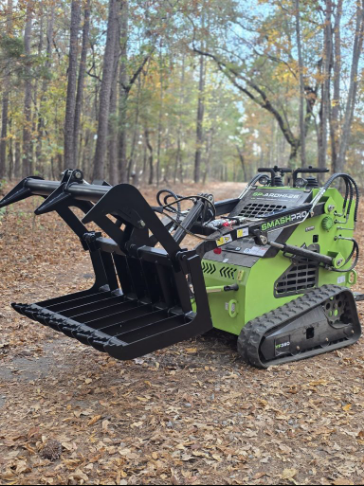
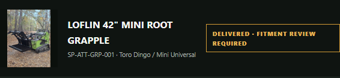

# Loflin mounted-grapple media update

Owner approved WordPress attachment **1067**, `20261113_152010.jpg`, for the existing SP-ATT-GRP-001 hero and showroom thumbnail, and **1063** for the secondary gallery. Both were retrieved through the authenticated WordPress core REST integration and visually inspected. No media uploads or WordPress writes were performed.

- Primary: https://smashpro.app/wp-content/uploads/2026/11/20261113_152010.jpg — JPEG, 1500 × 2000, 675733 bytes. Direct download returned HTTP 200, image/jpeg.
- Secondary: https://smashpro.app/wp-content/uploads/2026/11/20261113_152047.jpg — JPEG, 2000 × 1500.
- Delivery history retains https://smashpro.app/wp-content/uploads/2026/11/20261111_092910.jpg and the November 11, 2026 delivery milestone.

The media JSON files record the existing alt text, caption, dimensions, MIME type and every available responsive size. WordPress alt text and captions were empty for both attachments. Accessible alt text and the requested initial-fitment caption are supplied by the passport data without modifying WordPress. Only the existing uncropped 225/768/1152/1500-width primary variants enter the responsive hero and showroom srcset; WordPress landscape and square crops are excluded.

Current main at implementation baseline: `407db56`. Open PR #136 was reviewed; it contains the older pre-delivery passport proposal. This branch uses current receiving, manufacturer identity and pressure evidence without importing that older lifecycle.

Public status: **Delivered · Fitment Review Required**. The existing `commissioning` state, pending commissioning/field-test milestones, empty verified-host list, absent commissioned date and absent service link remain unchanged. The unresolved locking-pin issue is explicit: both pins must be fully engaged, inspected, and corrective action verified. The existing throttle-control hold is retained. No backend, service eligibility, deployment gate or operational authorization changes.

Validation and desktop/mobile screenshots are recorded with this change. No merge or deployment is part of this delivery.

- `npm.cmd run validate`: passed (exit 0), TypeScript, 215/215 unit tests, production build, public index, MZIGO media and passport artifact checks.
- `npx.cmd playwright test --config playwright.attachments.config.ts`: 2/2 passed at 1440 and 390 pixels. Real WordPress images loaded; hero aspect ratio and contain rendering checked; delivery and secondary-photo enlargement checked; one existing passport link in both featured and non-featured showroom positions; no horizontal overflow or page exceptions.
- `git diff --check`: passed.
- All six referenced originals/responsive URLs returned HTTP 200 with image/jpeg and decoded successfully at their documented dimensions.
- Corrected desktop/mobile hero and showroom thumbnails were visually reviewed. Existing Vite chunk-size and test HMR-port warnings did not prevent successful validation.

